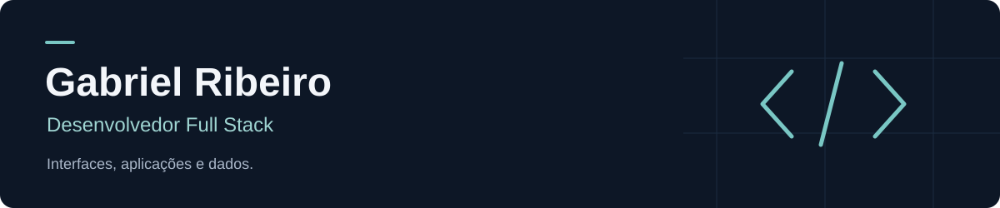

Sou Gabriel Ribeiro, desenvolvedor full stack com foco em aplicações web e interfaces que conectam pessoas, serviços e dados. Curso Técnico em Análise e Desenvolvimento de Sistemas na ETE Porto Digital.

Minha experiência prática reúne desenvolvimento com React, TypeScript e Firebase, além de estudos em Python e Django. Também trabalho com UI/UX e prototipação no Figma.

[Portfólio](https://gabriza007.github.io/portifolio/) · [LinkedIn](https://www.linkedin.com/in/gabriel-ribeiro-917441368) · [E-mail](mailto:gabrielribas.2801@gmail.com)

## Projeto em destaque

### Liga Caramelo

Plataforma para uma liga de basquete 3x3, com aplicação pública e painel administrativo.

- **Experiência pública:** notícias, calendário, classificação, perfis e estatísticas de atletas.
- **Gestão da competição:** equipes, convites, partidas e súmulas no painel administrativo.
- **Integração:** autenticação, dados em tempo real e controle de acesso com Firebase.
- **Qualidade:** interfaces para celular e computador, testes com Jest e validação de regras com emuladores.

Atuo na definição das funcionalidades, desenvolvimento das interfaces, integração dos serviços, revisão e validação dos fluxos, com apoio de ferramentas de IA no desenvolvimento.

**Tecnologias:** React · TypeScript · React Native Web · Expo · Firebase

[Conhecer a Liga Caramelo](https://liga-caramelo.web.app/) — código em repositórios privados.

## Outros projetos

| Projeto | Proposta | Tecnologias |
| --- | --- | --- |
| [Ponte Segura](https://github.com/gabriza007/ponte-segura) | Aplicação de alertas SOS para estudantes, com mapa e comunicação em tempo real. | React, TypeScript, Firebase, Leaflet |
| [Portfólio pessoal](https://github.com/gabriza007/portifolio) | Apresentação profissional com projetos carregados pela API do GitHub. | HTML, CSS, JavaScript |
| [Assistente de IA](https://github.com/gabriza007/IA) | Experimento de chat com histórico de sessão e integração com Gemini. | Python, Streamlit, Google Gen AI |

## Tecnologias e ferramentas

**Interfaces:** React, TypeScript, JavaScript, HTML, CSS, React Native Web e Expo.  
**Serviços e dados:** Firebase Authentication, Cloud Firestore e Firebase Hosting.  
**Design e qualidade:** Figma, Git, GitHub e Jest.  
**Estudos:** Python, Django e fundamentos de programação em C.

## Aprendizado em prática

[Exercícios em Python](https://github.com/gabriza007/curso-python-django) · [Fundamentos em C](https://github.com/gabriza007/c50-mesmo)

Meu foco é evoluir no desenvolvimento de aplicações completas, unindo interface, regras de negócio e persistência de dados.
